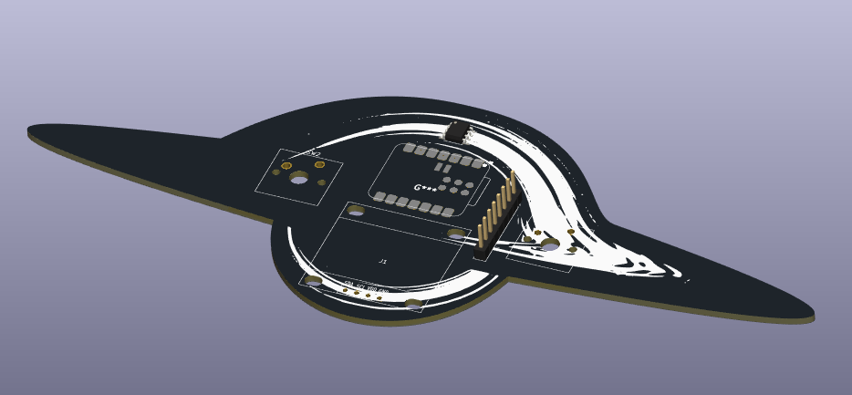

# My take on Starbie!
For week 1 of Hack Club Half Life, I followed the provided guide to build (and put my own spin on) Starbie. This version is designed with a space theme, with the silkscreen (graphics) and board shape based on Gargantua (the supermassive black hole in Interstellar). 
This current version uses a DS3231 Real-Time Clock (RTC) module to keep track of time, and a MPU6050 accelerometer. Combined, these sensors are theoretically (but not practically) enough to correct for relativistic time dilation.
